

<h2 align="center"></h2>

Banyak mahasiswa punya barang yang jarang dipakai: tripod, kalkulator ilmiah, alat praktikum, buku referensi. Mahasiswa lain hanya butuh barang itu sebentar. Selama ini urusannya lewat chat dan ingatan, sehingga jadwal mudah bentrok, barang lupa dikembalikan, dan tidak ada catatan.

BorrowMate merapikan seluruh prosesnya: **barang dipublikasikan, diajukan, disetujui, diserahkan, dikembalikan, lalu tercatat** sebagai riwayat dan ulasan.

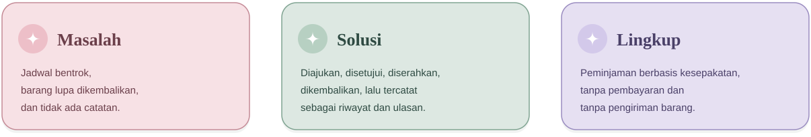

> [!NOTE]
> Lingkup tugas kuliah: peminjaman berbasis kesepakatan antar pengguna, tanpa pembayaran dan tanpa pengiriman barang.

<h2 align="center"></h2>

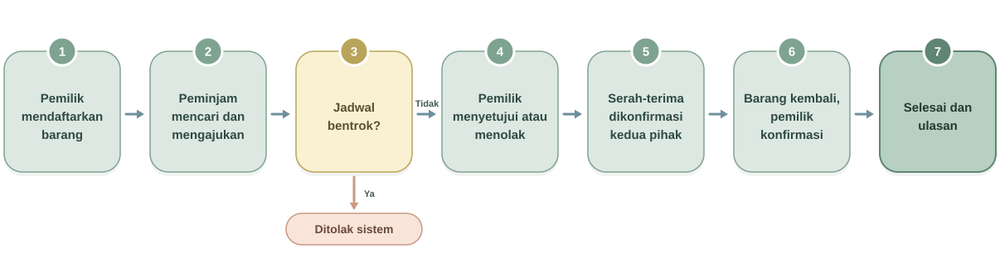

Lihat versi diagram yang bisa diedit (Mermaid)

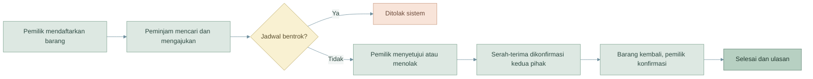

<h3 align="center"></h3>

Status akhir (Selesai, Ditolak, Dibatalkan) tidak bisa kembali ke status sebelumnya. Peminjaman baru dibuat sebagai transaksi baru.

<h2 align="center"></h2>

<table align="center">
  <tr>
    <td align="center" width="20%">
       
      <a href="https://github.com/Xzen-tech">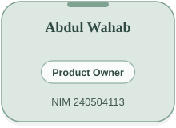</a>
    </td>
    <td align="center" width="20%">
       
      <a href="https://github.com/kecearif786-lgtm">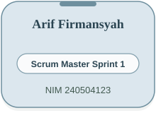</a>
    </td>
    <td align="center" width="20%">
       
      <a href="https://github.com/Riskafzti">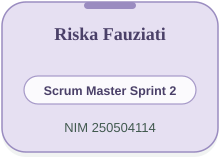</a>
    </td>
    <td align="center" width="20%">
       
      <a href="https://github.com/fariel-hub">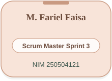</a>
    </td>
    <td align="center" width="20%">
       
      <a href="https://github.com/Afdeliliasaribrsembiring">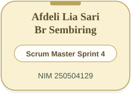</a>
    </td>
  </tr>
</table>

Peran Scrum Master bergilir tiap sprint. Semua anggota selain Product Owner juga bertugas sebagai Developer.

<h2 align="center"></h2>

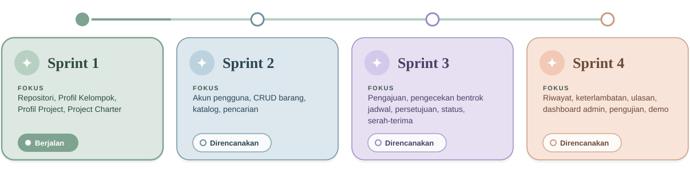

> [!TIP]
> Rencana Sprint 2 sampai 4 masih awal. Rinciannya ditetapkan saat Sprint Planning masing-masing sprint, mengikuti arahan dosen.

<h2 align="center"></h2>

<h2 align="center"></h2>

<table align="center">
  <tr>
    <td align="center" width="33%"><a href="Sprint-1/profil-kelompok.md">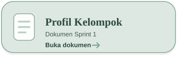</a></td>
    <td align="center" width="33%"><a href="Sprint-1/profil-project.md">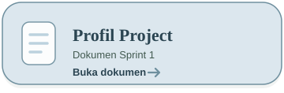</a></td>
    <td align="center" width="33%"><a href="Sprint-1/project-charter.md">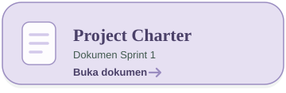</a></td>
  </tr>
</table>

 

