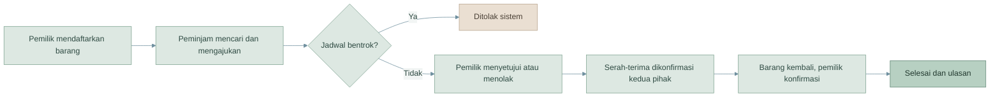
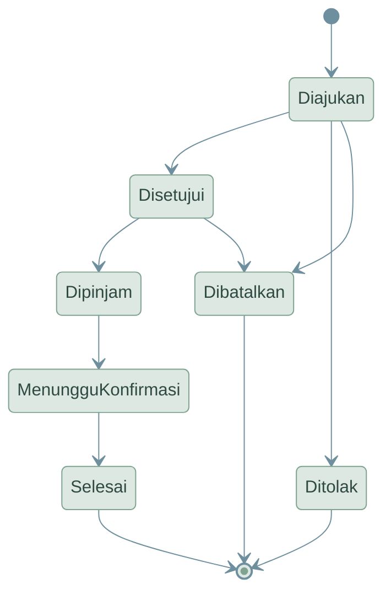

<div align="center">


<br>


</div>


## Kenapa BorrowMate?

Banyak mahasiswa punya barang yang jarang dipakai: tripod, kalkulator ilmiah, alat praktikum, buku referensi. Mahasiswa lain hanya butuh barang itu sebentar. Selama ini urusannya lewat chat dan ingatan, sehingga jadwal mudah bentrok, barang lupa dikembalikan, dan tidak ada catatan.

BorrowMate merapikan seluruh prosesnya: **barang dipublikasikan, diajukan, disetujui, diserahkan, dikembalikan, lalu tercatat** sebagai riwayat dan ulasan.

> [!NOTE]
> Lingkup tugas kuliah: peminjaman berbasis kesepakatan antar pengguna, tanpa pembayaran dan tanpa pengiriman barang.


## Cara kerja



### Siklus status transaksi



Status akhir (Selesai, Ditolak, Dibatalkan) tidak bisa kembali ke status sebelumnya. Peminjaman baru dibuat sebagai transaksi baru.


## Tim

<table align="center">
  <tr>
    <td align="center" width="20%">
      <a href="https://github.com/Xzen-tech"></a><br>
      <b>Abdul Wahab</b><br>Product Owner<br><sub>240504113</sub>
    </td>
    <td align="center" width="20%">
      <a href="https://github.com/kecearif786-lgtm"></a><br>
      <b>Arif Firmansyah</b><br>Scrum Master Sprint 1<br><sub>240504123</sub>
    </td>
    <td align="center" width="20%">
      <a href="https://github.com/Riskafzti"></a><br>
      <b>Riska Fauziati</b><br>Scrum Master Sprint 2<br><sub>250504114</sub>
    </td>
    <td align="center" width="20%">
      <a href="https://github.com/farielfaisa09-sudo"></a><br>
      <b>M. Fariel Faisa</b><br>Scrum Master Sprint 3<br><sub>250504121</sub>
    </td>
    <td align="center" width="20%">
      <a href="https://github.com/Afdeliliasaribrsembiring"></a><br>
      <b>Afdeli Lia Sari Br Sembiring</b><br>Scrum Master Sprint 4<br><sub>250504129</sub>
    </td>
  </tr>
</table>

<p align="center"><sub>Peran Scrum Master bergilir tiap sprint. Semua anggota selain Product Owner juga bertugas sebagai Developer.</sub></p>


## Roadmap

| Sprint | Fokus | Status |
|:---:|---|---|
| **1** | Repositori, Profil Kelompok, Profil Project, Project Charter | ● Berjalan |
| 2 | Akun pengguna, CRUD barang, katalog, pencarian | ○ Direncanakan |
| 3 | Pengajuan, pengecekan bentrok jadwal, persetujuan, status, serah-terima | ○ Direncanakan |
| 4 | Riwayat, keterlambatan, ulasan, dashboard admin, pengujian, demo | ○ Direncanakan |

> [!TIP]
> Rencana Sprint 2 sampai 4 masih awal. Rinciannya ditetapkan saat Sprint Planning masing-masing sprint, mengikuti arahan dosen.

## Teknologi

Python, Django (template HTML), HTML/CSS/JavaScript, SQLite saat pengembangan (MySQL bila diwajibkan), Git dan GitHub.


## Dokumen Sprint 1

- [Profil Kelompok](docs/sprint-1/profil-kelompok.md)
- [Profil Project](docs/sprint-1/profil-project.md)
- [Project Charter](docs/sprint-1/project-charter.md)

<details>
<summary><b>Struktur repositori</b></summary>

```
borrowmate/
├── README.md
├── .gitignore
├── assets/
│   ├── banner.svg
│   └── divider.svg
└── docs/
    ├── sprint-1/
    │   ├── profil-kelompok.md
    │   ├── profil-project.md
    │   └── project-charter.md
    └── anggota/            ← satu berkas profil per anggota
```

</details>

<details>
<summary><b>Cara berkontribusi</b></summary>

1. Ambil tugas dari **Issues** atau papan **Projects**.
2. Buat cabang: `git checkout -b feature/<nama-fitur>` (untuk dokumen: `profil/<nama>`).
3. Commit dengan pesan jelas: `feat:`, `fix:`, `docs:`, atau `chore:`, misalnya `docs: tambah profil Riska`.
4. Push, buka **Pull Request**, minta satu anggota lain meninjau.
5. Panduan langkah demi langkah untuk pemula: [`docs/anggota/README.md`](docs/anggota/README.md).

</details>

<br>

<p align="center"><sub>Dibuat bersama untuk tugas kuliah, satu sprint dalam satu waktu.</sub></p>
