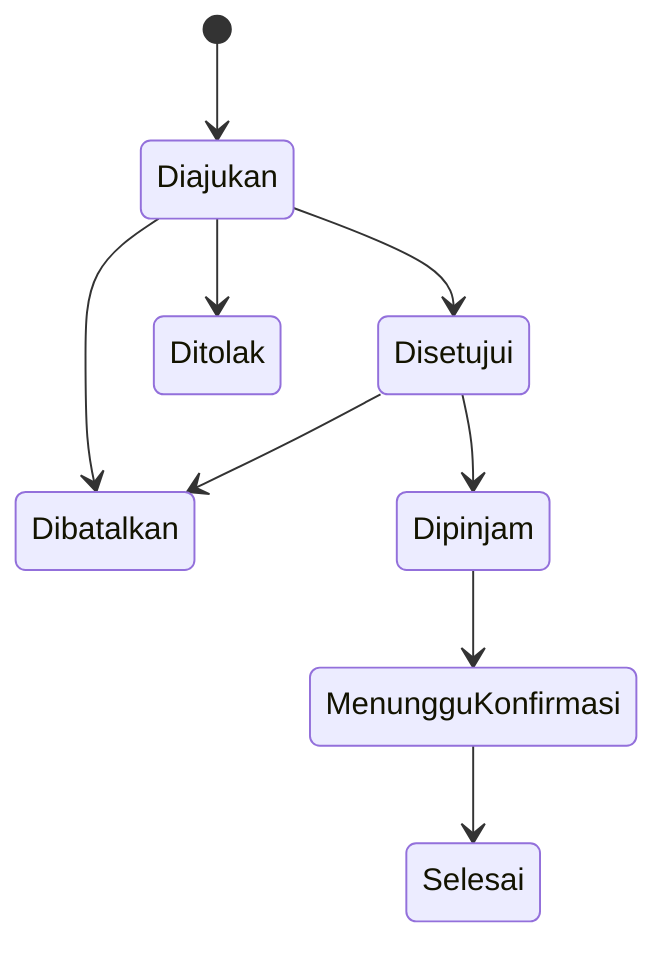
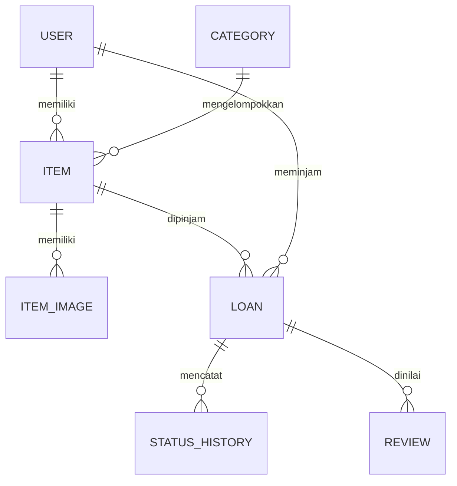

# 📘 Profil Project: BorrowMate

## Identitas

| Item | Keterangan |
|---|---|
| **Nama project** | BorrowMate |
| **Jenis** | Aplikasi web peminjaman barang antar mahasiswa |
| **Metode pengembangan** | Agile Scrum |
| **Repositori** | [https://github.com/RPLUNIT042026/RPL-Kelompok-4] |

## Latar Belakang

Banyak mahasiswa memiliki barang yang jarang digunakan, misalnya tripod, kalkulator, alat praktikum, buku referensi, atau perlengkapan kegiatan. Di sisi lain, mahasiswa lain sering membutuhkan barang tersebut hanya untuk waktu singkat. Peminjaman yang dilakukan secara informal (lewat pesan pribadi) rentan menimbulkan masalah: **jadwal bertabrakan, status barang tidak jelas, barang terlambat kembali, dan tidak ada catatan riwayat**.

## Tujuan

Mengelola proses peminjaman secara terstruktur, mulai dari publikasi barang, pengajuan, persetujuan, penyerahan, pengembalian, hingga pencatatan riwayat.

## Ruang Lingkup

| Termasuk (versi awal) | Tidak termasuk (versi awal) |
|---|---|
| Registrasi, login, profil | Pembayaran dan deposit online |
| Katalog barang beserta foto, kategori, kondisi, lokasi umum | Pengiriman / layanan logistik |
| Pencarian dan filter barang | Chat real-time |
| Pengajuan peminjaman dan pengecekan bentrok jadwal | Notifikasi email |
| Persetujuan/penolakan, konfirmasi serah-terima dan pengembalian | Penanganan laporan konflik tingkat lanjut |
| Riwayat, keterlambatan, ulasan, dashboard admin | |

Versi awal membatasi **satu transaksi aktif pada satu barang untuk rentang tanggal tertentu**.

## Pengguna dan Hak Akses

| Pengguna | Hak akses utama |
|---|---|
| **Pemilik barang** | Mendaftarkan barang, mengatur ketersediaan, menerima/menolak permintaan, mengonfirmasi penyerahan dan pengembalian |
| **Peminjam** | Mencari barang, mengajukan peminjaman, melihat status, mengonfirmasi penerimaan/pengembalian, memberi ulasan |
| **Administrator** | Memoderasi akun dan barang, mengelola kategori, melihat ringkasan transaksi |

Seorang mahasiswa dapat menjadi pemilik sekaligus peminjam; perannya ditentukan oleh hubungannya dengan barang pada transaksi tertentu.

## Fitur Utama

1. Registrasi, login, dan profil pengguna.
2. Katalog barang (foto, deskripsi, kategori, kondisi, lokasi umum, ketersediaan).
3. Pencarian dan filter berdasarkan kategori dan status ketersediaan.
4. Pengajuan peminjaman (tanggal mulai, tanggal rencana kembali, tujuan penggunaan).
5. Persetujuan atau penolakan oleh pemilik.
6. Manajemen status transaksi dengan aturan perpindahan yang jelas.
7. Konfirmasi serah-terima dan pengembalian oleh pihak terkait.
8. Pencatatan keterlambatan dan riwayat peminjaman.
9. Rating/ulasan setelah transaksi selesai, serta dashboard admin.

## Inti Teknis

**Pengecekan bentrok jadwal di sisi server.** Sebelum permintaan disetujui, sistem memeriksa transaksi lain pada barang yang sama agar rentang tanggal tidak tumpang tindih. Pemeriksaan dilakukan ulang pada saat persetujuan, bukan hanya saat pengajuan, untuk mencegah dua permintaan disetujui bersamaan.

## Rancangan Data Awal

Rancangan awal ini dapat disempurnakan saat Sprint Planning.

## Teknologi (rencana)

| Lapisan | Pilihan |
|---|---|
| Bahasa dan framework | Python, Django (template HTML) |
| Antarmuka | HTML, CSS, JavaScript |
| Basis data | SQLite saat pengembangan; MySQL bila diwajibkan |
| Kolaborasi | Git, GitHub (Issues, Projects, Pull Request) |

## Contoh Alur Penggunaan

1. Mahasiswa A mendaftarkan tripod (deskripsi, kondisi, foto, lokasi pengambilan umum, aturan peminjaman).
2. Mahasiswa B mencari tripod dan mengajukan peminjaman untuk tanggal tertentu.
3. Sistem memeriksa bentrok jadwal pada rentang tanggal tersebut.
4. Mahasiswa A menyetujui atau menolak. Bila disetujui, jadwal barang ditandai terpesan.
5. Saat barang diserahkan, kedua pihak mengonfirmasi dan status menjadi *dipinjam*.
6. Setelah dikembalikan, pemilik mengonfirmasi kondisi dan penerimaan, lalu transaksi *selesai*.
7. Kedua pihak dapat memberi ulasan; riwayat tersimpan di akun masing-masing.
