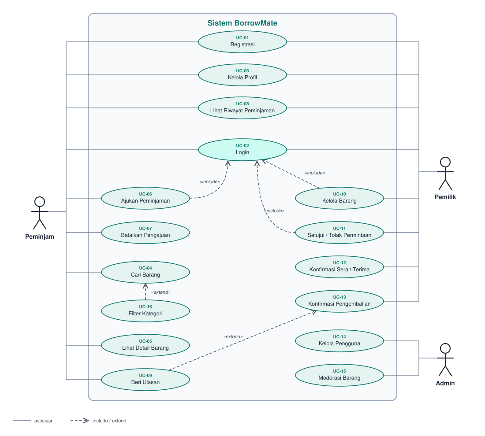

# 🎯 Use Case Diagram

[⬅️ Kembali ke README](../README.md)

---

## 🗺️ Diagram

  

> [!NOTE]
> Diagram digambar dengan notasi UML baku. Semua aktor, termasuk Admin, harus melakukan **Login (UC-02)** sebelum mengakses fungsi terproteksi. Relasi `«include»` digambar untuk UC-06, UC-10, dan UC-11 agar diagram tidak terlalu padat.

**Keterangan relasi**

| Relasi | Arti |
|---|---|
| Garis lurus | Aktor menjalankan use case |
| `«include»` | Use case selalu memanggil use case lain (peminjaman wajib login) |
| `«extend»` | Use case tambahan yang bersifat opsional (filter kategori, ulasan) |

## 📑 Daftar Use Case

| Kode | Use case | Aktor | Prioritas |
|---|---|---|:-:|
| UC-01 | Registrasi | Peminjam, Pemilik | M |
| UC-02 | Login | Semua | M |
| UC-03 | Kelola Profil | Peminjam, Pemilik | S |
| UC-04 | Cari Barang | Peminjam | M |
| UC-05 | Lihat Detail Barang | Peminjam | M |
| UC-06 | Ajukan Peminjaman | Peminjam | M |
| UC-07 | Batalkan Pengajuan | Peminjam | S |
| UC-08 | Lihat Riwayat Peminjaman | Peminjam, Pemilik | M |
| UC-09 | Beri Ulasan | Peminjam | C |
| UC-10 | Kelola Barang | Pemilik | M |
| UC-11 | Setujui atau Tolak Permintaan | Pemilik | M |
| UC-12 | Konfirmasi Serah Terima | Pemilik | S |
| UC-13 | Konfirmasi Pengembalian | Pemilik | M |
| UC-14 | Kelola Pengguna | Admin | S |
| UC-15 | Moderasi Barang | Admin | S |
| UC-16 | Filter Kategori | Peminjam | S |

## 📝 Spesifikasi Use Case

<b>UC-02 · Login</b>

 

| Item | Keterangan |
|---|---|
| Aktor | Peminjam, Pemilik, Admin |
| Deskripsi | Pengguna masuk ke sistem menggunakan akun terdaftar |
| Prakondisi | Pengguna sudah terdaftar |
| Pascakondisi | Pengguna masuk dan diarahkan ke halaman utama |

**Alur normal**

1. Pengguna membuka halaman login.
2. Pengguna mengisi NIM atau email dan kata sandi.
3. Sistem memvalidasi data.
4. Sistem membuat sesi dan menampilkan halaman utama.

**Alur alternatif**

- 3a. Data salah: sistem menampilkan pesan kesalahan dan pengguna dapat mencoba lagi.
- 3b. Akun dinonaktifkan admin: sistem menolak login dan menampilkan pemberitahuan.

<b>UC-06 · Ajukan Peminjaman</b>

 

| Item | Keterangan |
|---|---|
| Aktor | Peminjam |
| Deskripsi | Peminjam mengajukan permintaan meminjam barang pada periode tertentu |
| Prakondisi | Peminjam sudah login dan barang berstatus tersedia |
| Pascakondisi | Pengajuan tersimpan dengan status **Diajukan** dan pemilik menerima pemberitahuan |

**Alur normal**

1. Peminjam membuka detail barang dan memilih **Ajukan Pinjam**.
2. Sistem menampilkan formulir tanggal pinjam, tanggal kembali, dan catatan.
3. Peminjam mengisi formulir dan mengirim.
4. Sistem memvalidasi tanggal dan memeriksa bentrok jadwal.
5. Sistem menyimpan pengajuan dengan status Diajukan.
6. Sistem menampilkan konfirmasi dan memberi tahu pemilik.

**Alur alternatif**

- 4a. Tanggal tidak valid (kembali sebelum pinjam, atau melebihi 7 hari): sistem menolak dan meminta perbaikan.
- 4b. Jadwal bentrok dengan peminjaman lain: sistem menampilkan pesan dan meminta memilih tanggal lain.
- 1a. Peminjam adalah pemilik barang: tombol ajukan tidak ditampilkan (BR-02).

<b>UC-10 · Kelola Barang</b>

 

| Item | Keterangan |
|---|---|
| Aktor | Pemilik |
| Deskripsi | Pemilik menambah, mengubah, atau menghapus barang yang ditawarkan |
| Prakondisi | Pemilik sudah login |
| Pascakondisi | Data barang tersimpan atau diperbarui |

**Alur normal (tambah barang)**

1. Pemilik memilih **Tambah Barang**.
2. Sistem menampilkan formulir (nama, kategori, deskripsi, kondisi, foto).
3. Pemilik mengisi data dan menyimpan.
4. Sistem memvalidasi dan menyimpan barang dengan status Tersedia.
5. Sistem menampilkan barang pada daftar milik pemilik.

**Alur alternatif**

- 4a. Data wajib belum lengkap: sistem menandai kolom yang kurang.
- 4b. Foto tidak sesuai format atau terlalu besar: sistem menolak unggahan.
- Hapus barang: ditolak bila barang sedang dipinjam.

<b>UC-11 · Setujui atau Tolak Permintaan</b>

 

| Item | Keterangan |
|---|---|
| Aktor | Pemilik |
| Deskripsi | Pemilik menanggapi permintaan peminjaman yang masuk |
| Prakondisi | Pemilik sudah login dan ada pengajuan berstatus Diajukan |
| Pascakondisi | Status menjadi **Disetujui** atau **Ditolak** dan peminjam diberi tahu |

**Alur normal**

1. Pemilik membuka daftar permintaan masuk.
2. Pemilik memilih satu permintaan dan melihat detailnya.
3. Pemilik memilih **Setujui**.
4. Sistem memeriksa ulang bentrok jadwal, mengubah status, lalu memberi tahu peminjam.

**Alur alternatif**

- 3a. Pemilik memilih **Tolak**: sistem meminta alasan (opsional), mengubah status menjadi Ditolak, dan memberi tahu peminjam.
- 4a. Jadwal sudah terisi permintaan lain yang disetujui lebih dulu: sistem menolak persetujuan.

<b>UC-13 · Konfirmasi Pengembalian</b>

 

| Item | Keterangan |
|---|---|
| Aktor | Pemilik |
| Deskripsi | Pemilik memastikan barang sudah dikembalikan dalam kondisi yang sesuai |
| Prakondisi | Peminjaman berstatus **Dipinjam** |
| Pascakondisi | Status menjadi **Dikembalikan** dan barang kembali **Tersedia** |

**Alur normal**

1. Pemilik membuka peminjaman yang sedang berjalan.
2. Pemilik memeriksa barang yang diterima kembali.
3. Pemilik memilih **Konfirmasi Pengembalian**.
4. Sistem mencatat tanggal pengembalian, mengubah status peminjaman, dan mengembalikan status barang menjadi Tersedia.

**Alur alternatif**

- 3a. Barang rusak atau tidak lengkap: pemilik mengisi catatan kondisi sebelum konfirmasi.
- 4a. Tanggal kembali sudah lewat: sistem menandai peminjaman sebagai terlambat.

