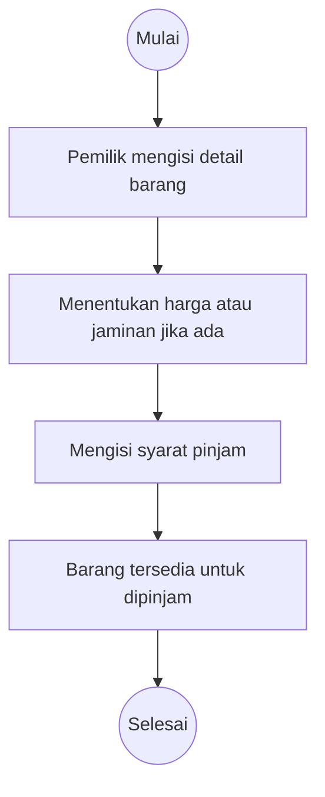
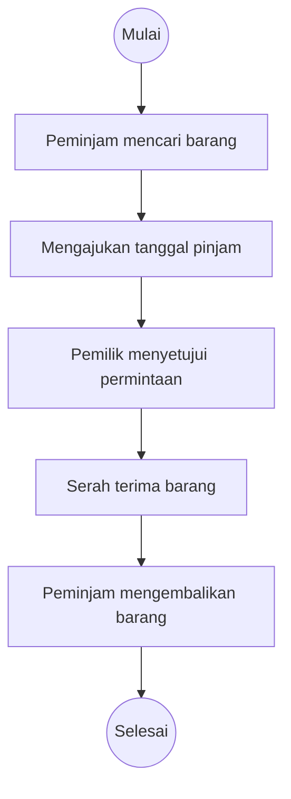

# 🔄 Activity Diagram (Wajib)

Menggambarkan alur proses bisnis dari awal hingga selesai secara berurutan.

## 1. Alur Unggah Barang

Pemilik mengisi detail barang, harga/jaminan (jika ada), dan syarat pinjam. Setelah informasi barang diisi, barang tersedia untuk dipinjam.

### Activity Diagram Alur Unggah Barang

## 2. Alur Transaksi Peminjaman

Peminjam mencari barang, mengajukan tanggal pinjam, pemilik menyetujui permintaan, kemudian dilakukan serah terima barang dan pengembalian barang hingga transaksi selesai.

### Activity Diagram Alur Transaksi Peminjaman

