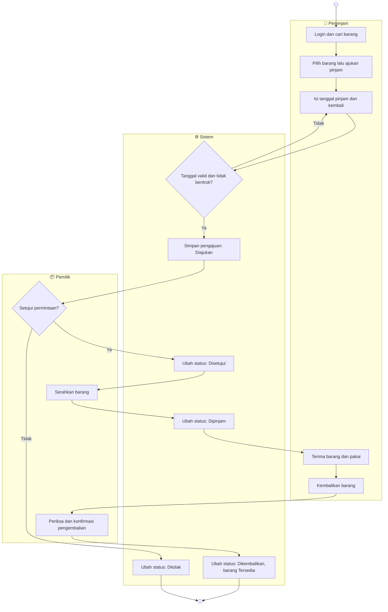
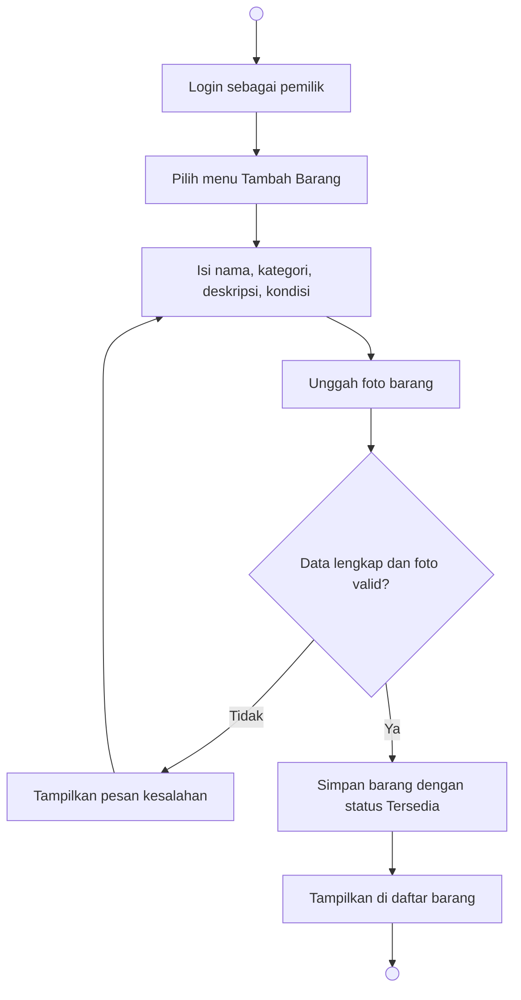
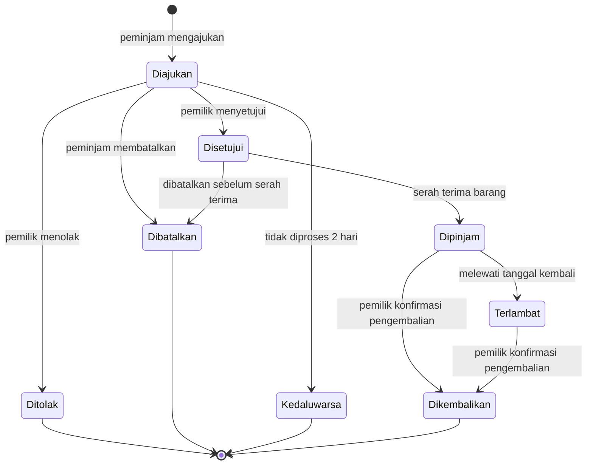
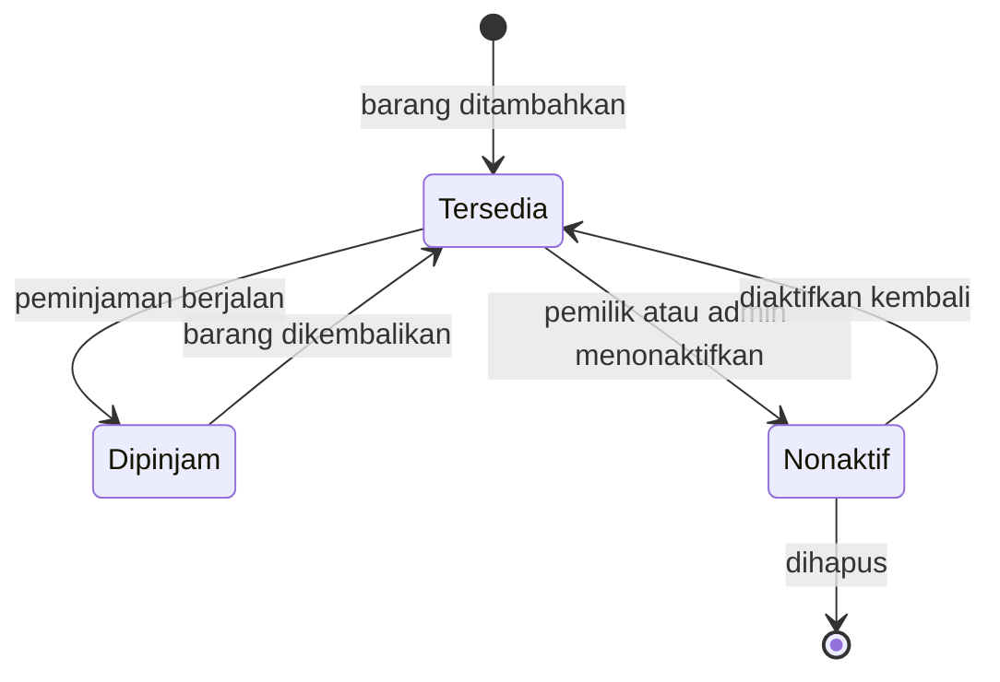

# 🔀 Activity & State Diagram

[⬅️ Kembali ke README](../README.md)

---

## 1. Activity Diagram: Proses Peminjaman

Diagram memperlihatkan alur dari pengajuan sampai barang kembali, dengan tiga jalur tanggung jawab (*swimlane*): Peminjam, Sistem, dan Pemilik.

## 2. Activity Diagram: Tambah Barang

## 3. State Diagram: Status Peminjaman

| Status | Arti |
|---|---|
| Diajukan | Menunggu tanggapan pemilik |
| Disetujui | Pemilik setuju, menunggu serah terima |
| Dipinjam | Barang sedang berada di peminjam |
| Dikembalikan | Barang sudah kembali ke pemilik |
| Terlambat | Barang belum kembali setelah tanggal kembali |
| Ditolak / Dibatalkan / Kedaluwarsa | Peminjaman tidak jadi berlangsung |

## 4. State Diagram: Status Barang

