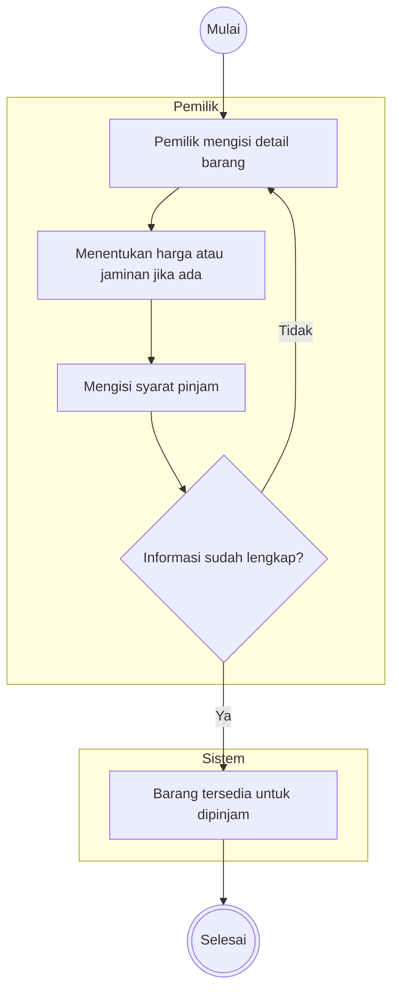
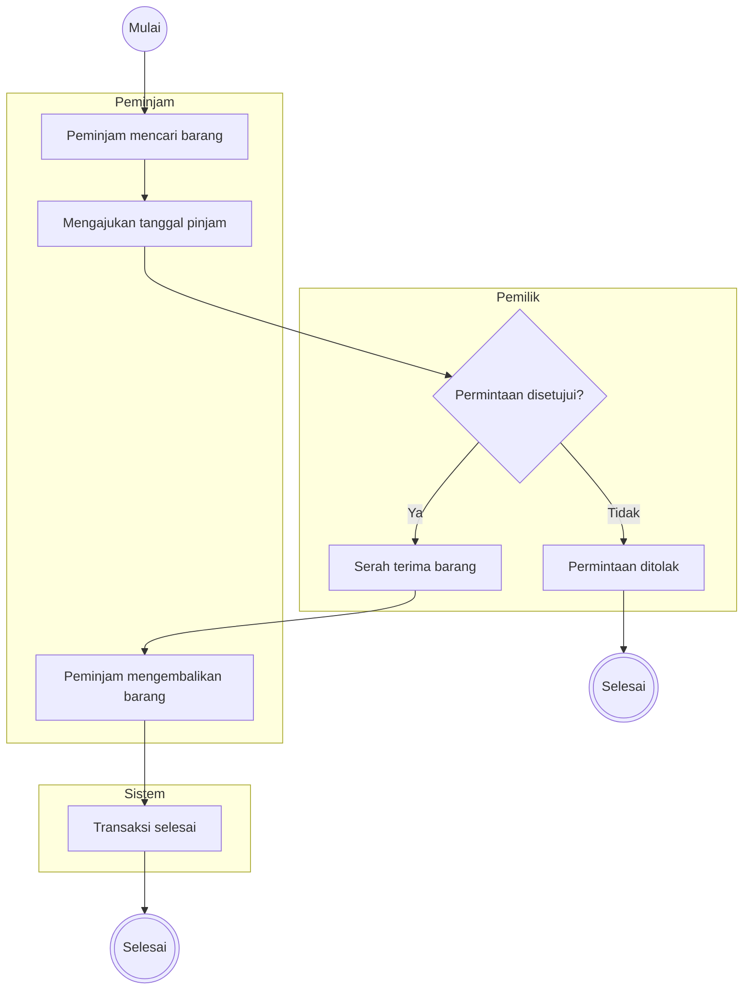

# 🔄 Activity Diagram (Wajib)

Menggambarkan alur proses bisnis dari awal hingga selesai secara berurutan.

## 1. Alur Unggah Barang

Pemilik mengisi detail barang, harga/jaminan (jika ada), dan syarat pinjam. Setelah informasi barang diisi, barang tersedia untuk dipinjam.

### Activity Diagram Alur Unggah Barang (dengan simbol)

## 2. Alur Transaksi Peminjaman

Peminjam mencari barang, mengajukan tanggal pinjam, pemilik menyetujui permintaan, kemudian dilakukan serah terima barang dan pengembalian barang hingga transaksi selesai.

### Activity Diagram Alur Transaksi Peminjaman (dengan simbol)

## 3. Keterangan Simbol Activity Diagram

| No. | Nama Simbol | Bentuk / sintaks Mermaid | Keterangan |
|---|---|---|---|
| 1 | Start State | `A((Mulai))` | Menandai awal aktivitas/proses. |
| 2 | End State | `A(((Selesai)))` | Menandai akhir aktivitas/proses. |
| 3 | Swimlane | `subgraph Nama ... end` | Mengelompokkan aktivitas berdasarkan pelaku atau fungsi. |
| 4 | Transition | `A --> B` | Menunjukkan hubungan/alur antar simbol. |
| 5 | Decision | `A{Kondisi?}` | Menunjukkan percabangan berdasarkan kondisi, misalnya Ya/Tidak. |
| 6 | State | `A([Nama keadaan])` | Menunjukkan keadaan atau kondisi sistem. |
| 7 | Fork / Join | Bar tebal pada notasi UML Activity Diagram | Menunjukkan pemecahan atau penggabungan aktivitas paralel. |

**Catatan:** Mermaid memakai bentuk flowchart yang mendekati simbol pada referensi. Swimlane ditampilkan sebagai kelompok `subgraph`. Simbol Fork/Join UML berupa bar tebal tidak direpresentasikan persis oleh flowchart Mermaid.
