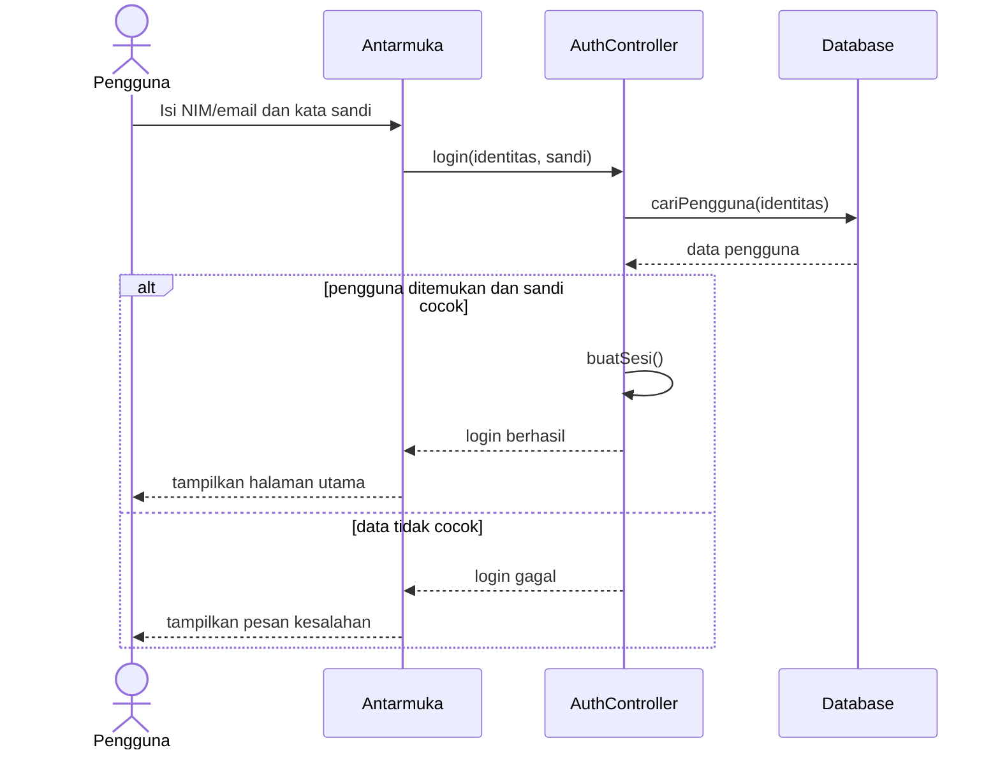
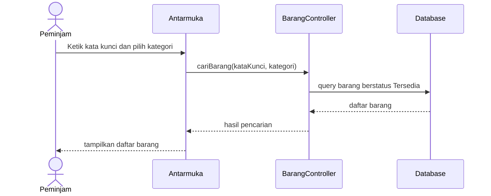
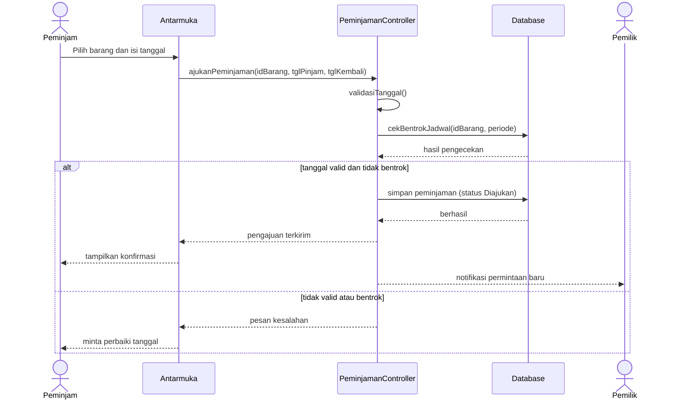
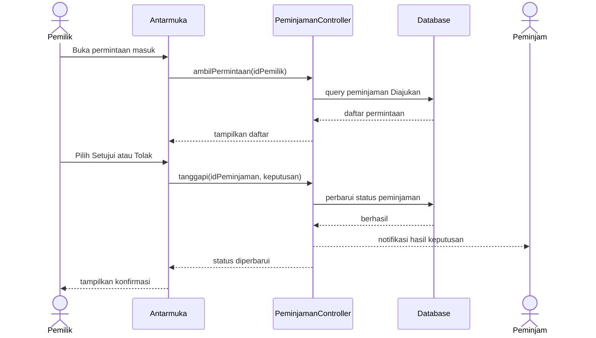
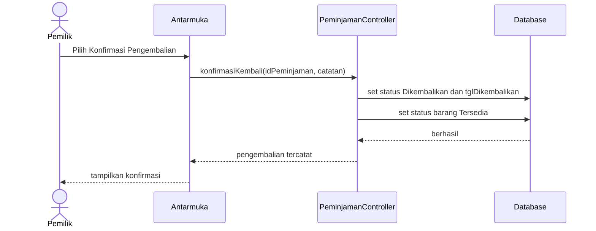

# ⏱️ Sequence Diagram

[⬅️ Kembali ke README](../README.md)

---

Lapisan yang digunakan: **Antarmuka** (halaman web), **Controller** (logika alur), dan **Database**.

## 1. Login

## 2. Cari Barang

## 3. Ajukan Peminjaman

## 4. Setujui atau Tolak Permintaan

## 5. Konfirmasi Pengembalian

