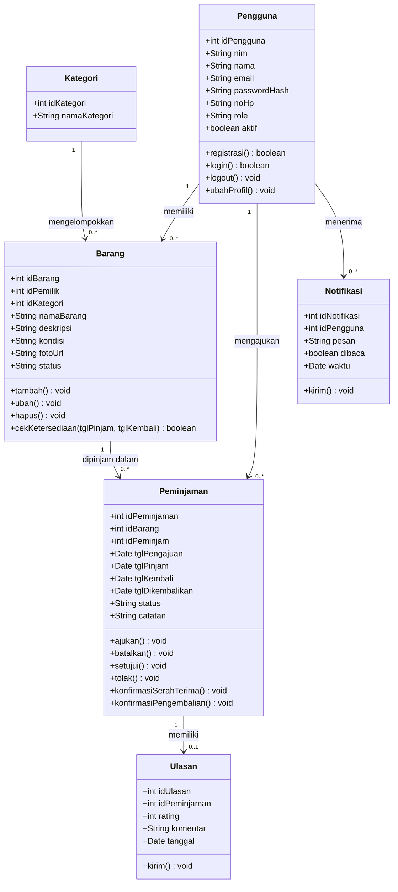
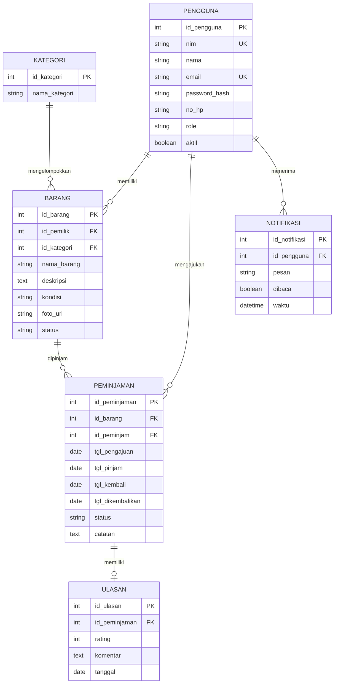

# 🧱 Class Diagram & ERD

[⬅️ Kembali ke README](../README.md)

---

## 1. Class Diagram

### Kamus Kelas

| Kelas | Tanggung jawab |
|---|---|
| Pengguna | Menyimpan data akun mahasiswa dan admin. Atribut `role` bernilai `mahasiswa` atau `admin` |
| Kategori | Pengelompokan barang (dokumentasi, kalkulator, alat praktikum, buku, perlengkapan kegiatan) |
| Barang | Data barang yang ditawarkan pemilik beserta statusnya |
| Peminjaman | Transaksi peminjaman dan seluruh siklus statusnya |
| Ulasan | Penilaian peminjam terhadap peminjaman yang selesai |
| Notifikasi | Pemberitahuan perubahan status kepada pengguna |

### Nilai Status

| Atribut | Nilai |
|---|---|
| `Barang.status` | Tersedia, Dipinjam, Nonaktif |
| `Peminjaman.status` | Diajukan, Disetujui, Ditolak, Dibatalkan, Kedaluwarsa, Dipinjam, Terlambat, Dikembalikan |

## 2. Entity Relationship Diagram

ERD merupakan turunan class diagram untuk perancangan basis data.

## 3. Konsistensi Antar Diagram

| Diagram | Menjawab pertanyaan | Mengacu ke |
|---|---|---|
| Use Case | Apa yang bisa dilakukan tiap aktor? | Analisis kebutuhan |
| Activity | Bagaimana alur prosesnya? | Use case |
| State | Bagaimana status berubah? | Activity dan class |
| Sequence | Bagaimana objek saling berinteraksi? | Use case dan class |
| Class | Apa struktur data dan perilaku sistem? | Seluruh diagram di atas |
| ERD | Bagaimana data disimpan? | Class diagram |
